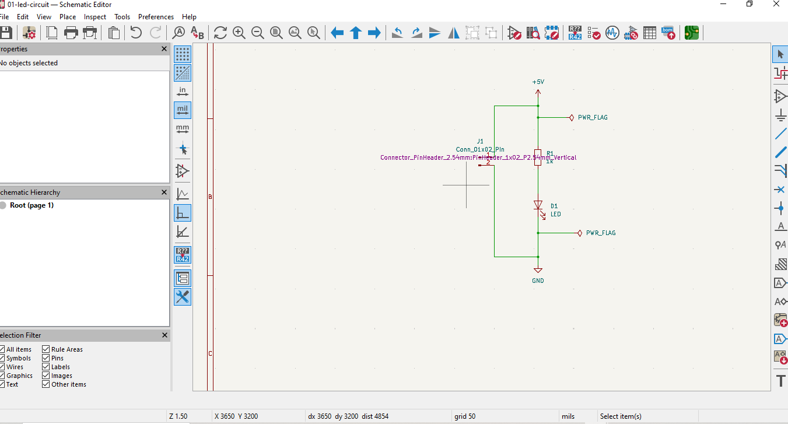
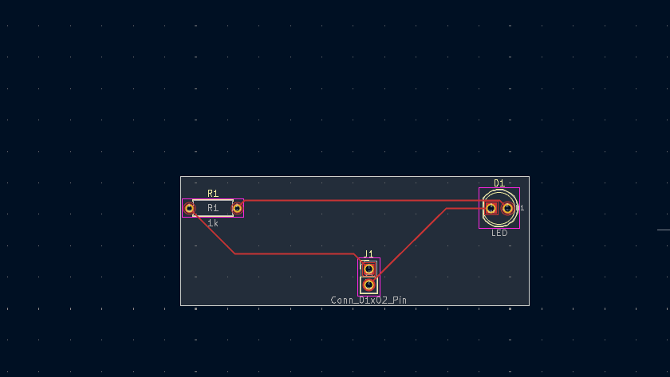

# Project 01: LED Circuit Design Using KiCad

## Project Overview
This is my first PCB design project as I learn electronics and printed circuit board (PCB) design. I designed a basic LED circuit using KiCad.

The circuit uses a 5V power input, a 1kΩ resistor, and an LED.

## Project Objectives
- Understand basic electronic circuit connections.
- Create an electronic schematic in KiCad.
- Assign component footprints.
- Transfer the schematic to the PCB editor.
- Arrange components on a PCB.
- Route copper tracks between components.
- Run the Design Rules Checker (DRC).

## Components Used
- 1 × LED
- 1 × 1kΩ resistor
- 1 × 2-pin connector for the power input
- 5V DC power source

## Circuit Operation
The 5V supply provides power to the circuit. Current flows through the 1kΩ resistor and the LED when the circuit is connected with the correct polarity.

The resistor limits the current flowing through the LED, helping protect it from excessive current.

## Tools Used
- KiCad — schematic capture and PCB layout
- Git and GitHub — version control and project documentation

## Progress
- [x] Created the schematic.
- [x] Connected the circuit components.
- [x] Assigned component footprints.
- [x] Transferred the schematic to the PCB editor.
- [x] Arranged components and created the board outline.
- [x] Routed the copper tracks.
- [x] Achieved zero DRC errors in the current design check.
- [ ] Review manufacturing requirements.
- [ ] Generate Gerber and drill files.
- [ ] Manufacture or test the physical PCB.

## What I Learned
Through this project, I practised the relationship between an electronic schematic and a physical PCB layout. I also learned about component footprints, electrical nets, copper routing, board outlines, and design-rule checking.

## Project Status
PCB layout completed as an initial learning prototype. Manufacturing preparation and physical testing are still pending.

## Screenshots
1. circuit schematic

2. PCB layout

